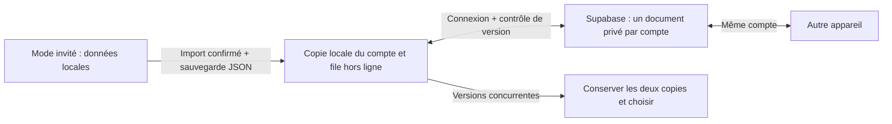
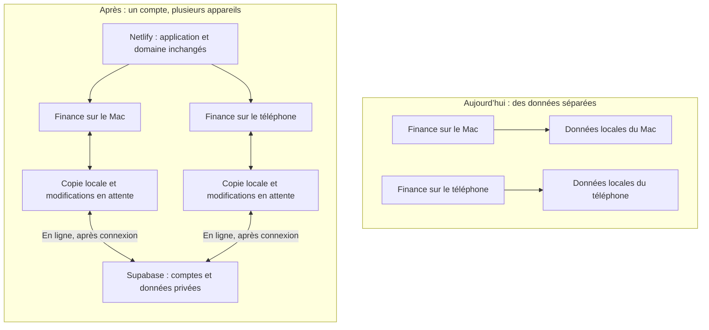

# Finance — Plan d’intégration de Supabase

## Partie 1 — Comprendre la direction et décider

### État de la première implémentation — 10 novembre 2026

La connexion, l’import volontaire des données invitées et la synchronisation
hors ligne sont implémentés. Les deux migrations ont été appliquées au projet
Supabase connecté. Aucune donnée financière réelle n’a été importée et la
nouvelle application n’a pas encore été publiée sur Netlify.

**Ajustement par rapport au plan initial :** cette première livraison conserve
un document de budget complet, versionné et privé par utilisateur, plutôt que
de répartir chaque ligne entre plusieurs tables. Cela conserve les imports et
restaurations atomiques. En contrepartie, deux appareils qui modifient le budget
en parallèle doivent choisir explicitement une des deux copies ; les changements
ne sont pas fusionnés ligne par ligne. Les deux versions sont exportables avant
de décider. La normalisation et la fusion fine restent des évolutions futures.

Il reste à configurer les URL de connexion et l’envoi d’e-mails dans Supabase,
publier le frontend, puis valider une vraie connexion sur deux appareils.
Les instructions exactes sont dans [`SUPABASE.md`](./SUPABASE.md).
Le reste du document conserve la proposition initiale comme référence ; les
tables normalisées et la synchronisation par entité ne font pas partie de cette
première livraison.

### L’objectif

Retrouver les mêmes budgets et opérations sur ton ordinateur et ton téléphone,
en te connectant au même compte. Aujourd’hui, chaque navigateur conserve ses
propres données : une modification sur le Mac n’apparaît pas sur le téléphone.

Netlify continue de servir l’application sur `finance.victorsauter.com`.
Supabase ajoute les comptes utilisateurs et une base de données commune aux
appareils d’un même utilisateur. L’interface et les calculs de budget sont
conservés.

### Avant et après

Les deux appareils accèdent aux données du même compte, sans avoir besoin de
rester ouverts en même temps. Hors connexion, tu continues à modifier la copie
locale ; les modifications sont envoyées quand la connexion revient. Si deux
appareils modifient la même donnée en parallèle, l’application signale le conflit
au lieu d’effacer silencieusement une des versions.

### Ce que cela change pour toi

- **Un compte pour synchroniser** : connexion par code reçu par e-mail proposée
  pour la première version.
- **Des données conservées en ligne** : les budgets et les opérations confirmées
  sont transmis à Supabase après ton accord. Chaque compte reste privé.
- **Un fonctionnement hors ligne conservé** : un indicateur distingue les données
  enregistrées sur l’appareil de celles effectivement synchronisées.
- **Une reprise des données existantes** : l’application présente ce qu’elle va
  importer avant de l’envoyer. Les fichiers de sauvegarde JSON restent utilisables.
- **Les relevés CSV restent sur l’appareil** : seules les opérations structurées
  que tu confirmes sont synchronisées, pas le fichier bancaire original.

La synchronisation n’est pas une sauvegarde historique : une suppression peut
se propager aux autres appareils. Nous conservons donc aussi l’export JSON et
prévoyons une procédure de sauvegarde/restauration de la base.

### Le déroulement proposé

1. **Protéger l’existant** : sauvegarder les données présentes sur chaque appareil.
2. **Préparer Supabase** : créer les comptes, la base et les protections d’accès.
3. **Connecter Finance** : ajouter la connexion et la synchronisation hors ligne.
4. **Reprendre tes données** : prévisualiser et confirmer l’import de tes budgets.
5. **Valider avant généralisation** : tester avec ton compte sur deux appareils,
   puis activer progressivement et vérifier la restauration des sauvegardes.

### Les décisions à prendre

- **Périmètre proposé** : comptes individuels privés. Le partage d’un budget entre
  plusieurs personnes viendrait dans une étape distincte.
- **Connexion proposée** : code par e-mail. Il faut choisir un service d’envoi
  adapté à la production.
- **Disponibilité et budget** : commencer avec Supabase Free pour tester, ou
  choisir Pro si l’absence de mise en pause et les sauvegardes automatiques sont
  nécessaires dès le départ. Les limites et tarifs vérifiés figurent en partie 2.
- **Hors ligne** : le conserver implique une vraie gestion des conflits. C’est le
  choix retenu dans ce plan pour préserver le comportement actuel de Finance.

**Résultat attendu pour valider la migration :** tu modifies un budget sur le
Mac, tu le retrouves sur le téléphone, une modification hors ligne n’est pas
perdue, et un autre compte ne peut pas lire tes données.

La proposition initiale ci-dessous est conservée pour référence. L’état actuel
et les écarts de livraison sont indiqués en tête du document.

---

## Part 2 — Technical implementation plan

Planning date: 10 November 2026. Original proposal retained for reference.
Delivery 1 uses an atomic versioned document, not the normalized entity model
described below. See `SUPABASE.md` for the actual implementation, applied
migrations, validation, rollout and recovery instructions. DNS and frontend
production deployment have not been changed by this implementation.

## 1. Recommendation and scope

Keep the existing Netlify deployment, `finance.victorsauter.com`, React, Vite,
TypeScript and budget calculations. Add Supabase for authentication, PostgreSQL
and its authenticated Data API. Retain IndexedDB for offline work and pending
changes. Frontend hosting and DNS migration are outside this plan.

The goal is to recover the same private budget data on another device after
sign-in, while preserving offline editing and existing JSON backups. A framework
rewrite, Kubernetes cluster and custom backend are not required for this scope.

Planning assumptions: individual accounts, one private dataset per user,
continued offline support, no household sharing or live bank connection in v1.
Application copy and technical documentation remain English. Planning documents
start with a plain-language French decision section and a visual diagram,
followed by the detailed technical implementation in English. Use emojis only
when they communicate something useful rather than decorate the document.

## 2. Supabase services and operating constraints

### Initial service choices

Use Supabase Auth for accounts, PostgreSQL for records and RLS for isolation.
Start with the authenticated Data API and transactional database RPCs. Defer
Realtime and file Storage: neither is needed for the first synchronised version.
Original bank CSV files continue to be parsed locally; only confirmed structured
transactions are uploaded.

The Netlify build remains `npm run build` with output `dist`. Its application
updates will introduce the Supabase client, account screens and sync status.
Configure production and preview environments separately; previews must use
staging or local Supabase rather than the production dataset.

### Costs and constraints verified from official pages

- Free includes 500 MB database size, but projects with low activity over seven
  days can pause and automatic backups are not included.
- Pro starts at USD 25/month for the base configuration; extra projects, compute
  and usage can add cost. Production authentication email delivery may have a
  separate provider cost.

Prices are list prices, not an account-specific quote; verify tax, add-ons and
usage before subscribing. A pilot may fit Supabase Free. The existing Netlify
subscription remains separate. Choose a paid database based on recovery and
availability needs, not just size.

## 3. Findings from the code

- `src/domain/budget/models.ts`: version 2 data contains budget months, nested
  incomes/accounts/categories/items, settings and imported transactions. UUIDs
  and integer-cent monetary values should be preserved.
- `src/data/indexeddb/IndexedDbBudgetRepository.ts`: the current repository
  reads and writes the entire application document under one local record.
- `src/data/LocalBudgetStore.ts`: a local promise queue serialises whole-document
  saves. It does not coordinate different devices or browser tabs.
- `src/app/BudgetContext.tsx`: constructs the IndexedDB store directly. Every
  edit clones the whole dataset. Reset, restore and multi-entity deletions have
  local semantics that must be redesigned explicitly for a cloud account.
- `src/domain/transactions/revolut-csv.ts`: CSV parsing and source-key
  deduplication run locally. Preserve them and enforce deduplication server-side
  too. Do not upload original statements by default.
- `src/features/backup/BackupPage.tsx`: versioned JSON export, validation and
  confirmation already exist and can support onboarding and recovery.
- `vite.config.ts`: an auto-updating offline PWA exists. Cached versions and
  stale tabs must be included in migration testing.

## 4. Intended architecture and data boundaries

Netlify serves the static application. The browser signs in through Supabase
Auth, then accesses the Data API with the user session and a publishable key.
PostgreSQL Row Level Security (RLS) authorises every account-owned row. Use
server functions only for operations that genuinely need server credentials or
atomic multi-table work; authenticated PostgreSQL RPCs can cover the latter.

Store only `VITE_SUPABASE_URL` and `VITE_SUPABASE_PUBLISHABLE_KEY` in the browser
build. A publishable key is public by design and does not replace RLS. Never
place secret/service-role keys, database passwords or SMTP credentials in Vite
variables. Prefer user-scoped RPCs with invoker permissions; audit any function
that bypasses RLS separately.

Supabase is the confirmed shared state. IndexedDB holds the current user's
cache, an importable guest dataset and a durable pending-operation queue.
Namespace cache and queue by authenticated user ID. Stop writes, cancel pending
requests/subscriptions and remove the previous account's in-memory state on
sign-out or account switch. Never upload a guest dataset to an account silently.

## 5. Ordered implementation work

### Phase A: preserve data and establish the baseline

1. Export a JSON backup from every origin/device that may contain unique data:
   `finance.victorsauter.com`, the Netlify URL and localhost have separate storage.
2. Record the production Git SHA and installed PWA behaviour. Keep the existing
   domain and Netlify configuration.
3. Re-run build, lint and existing tests; install Playwright's Chromium and run
   desktop/mobile tests. No production migration depends on an untested branch.
4. Create or select a Supabase project and choose an EU region if appropriate
   for the users; region alone does not establish regulatory compliance. Set up
   a local or separate staging project before applying production migrations.

Exit condition: restorable backups and a reproducible application baseline.

### Phase B: Supabase schema, authentication and isolation

1. Use versioned SQL migrations and generated TypeScript database types. Separate
   staging and production; previews must not mutate production data. Free tier
   limits may influence whether staging is local or a second hosted project.
2. Add Supabase Auth, session handling, sign-in/out, account switching and account
   recovery. Suggested v1: email OTP with a production SMTP provider. Confirm the
   provider and allowed redirect origins before enabling real users. Supabase's
   default email service is restricted and is not suitable for production.
   Configure `https://finance.victorsauter.com` as the production site URL and
   explicitly allow required local/staging callback URLs. Add the publishable
   URL/key to the appropriate Netlify build environments and rebuild the app.
3. Proposed tables: `profiles`, `budget_months`, `incomes`, `accounts`,
   `expense_categories`, `expense_items`, `import_batches`,
   `imported_transactions`, `user_settings`, plus sync/import receipts. Preserve
   existing entity IDs and sorting. Store financial amounts as integer cents;
   transaction amounts are signed, fees are nonnegative.
4. Include `user_id`, server-managed revision/change metadata and deletion
   markers where needed. Enforce unique `(user_id, year, month)` budget months
   and `(user_id, provider, source_key)` imported transactions. Deduplication
   must never suppress another user's import.
5. Enable and test RLS for SELECT/INSERT/UPDATE/DELETE on every exposed table.
   Users must not change ownership. Use ownership-aware composite foreign keys
   or equivalent database constraints to prevent references to another user's
   accounts/categories. Category assignment must also match the transaction month.
6. Make imports, month cloning, account/category deletion and cloud restores
   atomic where they modify several rows. Preserve current transaction retention
   rules when deleting a budget/category. Server-side validation must cover
   current Zod invariants rather than trusting the client.

Exit condition: tests with accounts A/B and no session prove that cross-account
reads, writes and foreign-key references are rejected, including RPC paths.

### Phase C: persistence integration and reliable offline sync

1. Decouple persistence construction from `BudgetProvider`. Keep domain code and
   UI-facing models stable; adapt SQL rows through a repository/mapping layer.
2. Evolve beyond whole-document `save(data)` for the sync boundary. Add explicit
   operations such as update entity, delete entity, import batch and restore.
   Replacing the repository alone would introduce whole-account lost updates.
3. In one IndexedDB transaction, apply each local edit and enqueue its operation.
   Every operation carries a stable mutation ID, expected server revision and
   user ID. Only a matching authenticated session may flush that user's queue.
4. Apply remote writes atomically with revision checks and idempotency receipts;
   retrying after a lost response must not duplicate data. Accept changes to
   independent entities; surface a conflict for concurrent edits to the same
   entity. Avoid silent last-writer-wins on financial records.
5. Use server-issued change ordering/cursors, acknowledgements and deletion
   markers so reconnecting devices do not resurrect deleted records. Fetch a
   fresh server baseline before reapplying unsent operations. Never rely on
   client timestamps as the sole conflict mechanism.
6. Initially refresh on sign-in, focus, reconnect and manual request. Realtime
   is optional and is not a replacement for reconciliation after disconnection.
7. UI states must distinguish saved locally, pending sync, synced, offline and
   conflict/error. A pending write must not be labelled backed up remotely.

Exit condition: edits survive refresh and offline use, sync once after reconnect,
and cannot overwrite newer changes from another device without resolution.

### Phase D: explicit first import and safe restore semantics

1. Offer a signed-in user a preview of their local budgets and transactions,
   with a clear explanation that confirmed data will be uploaded to Supabase.
2. For a new empty cloud account, import the validated dataset atomically. Preserve
   source IDs/keys. Use an import receipt to make retries idempotent. For large
   datasets, stage chunks and finalise atomically instead of leaving a partial
   active account after a failure.
3. If the account already has cloud data, do not automatically overwrite it.
   Present a comparison and explicit import/merge choices. Conflicting months
   require a resolution; duplicate transaction keys must not duplicate records.
4. Retain the local snapshot and external JSON backup until count checks,
   per-month income/expense totals, links and cross-device reload all match.
5. Redesign current Reset/Restore controls: distinguish local cache removal from
   deleting account data. A cloud-wide reset/replace needs a separate confirmation,
   a backup and transactional server handling.
6. Update privacy/offline copy: synced records leave the device; original CSV files
   remain local unless an explicit future upload feature is added.

Exit condition: interrupted/repeated imports are safe, the target account is
confirmed and the user can recover the pre-migration snapshot.

### Phase E: controlled release and recovery

1. Release cloud functionality behind a feature flag, starting with one pilot
   account and two devices. Use additive database migrations so old deployed
   clients remain compatible during the cutover.
2. Verify sign-in/recovery on the final HTTPS origin, sign-out isolation, offline
   reconciliation and PWA upgrade from an already installed build. Prompt stale
   local-only clients to refresh before an import can be considered complete.
3. Monitor sync failures/conflicts and database usage without logging statements,
   balances, access tokens or full transaction descriptions.
4. Configure and test database backup/restore. Keep JSON export. If using Free,
   arrange protected off-site dumps; paid daily backups are a separate operational
   choice. Establish a retention period and test a restore into staging.
5. Application rollback: disable cloud writes and restore a compatible Netlify
   deployment. Preserve server data and pending queues before reconciliation;
   a code rollback does not undo database changes. Keep SQL migrations additive
   during rollout so previously deployed clients can still read their data.
6. Deleting obsolete Kubernetes resources is separate from this integration and
   requires an explicit resource review; it is not a prerequisite for Supabase.

Exit condition: production checks pass on the existing Netlify domain and a
tested recovery path exists for both confirmed cloud data and pending edits.

## 6. Acceptance checklist

- Existing money, month cloning, CSV deduplication and schema tests still pass.
- Two-user isolation tests exercise each table and each write/RPC operation.
- Repeated imports, retries and a lost server response do not duplicate records.
- Editing two devices offline produces a safe reconciliation or visible conflict.
- A delete on one device is not resurrected by a stale device.
- Logging into a second account never displays or uploads the first account's cache.
- Guest data never syncs without confirmation.
- Import cancellation, invalid backup, partial import and interrupted migration
  preserve a recoverable original.
- Deep links, auth redirects, production HTTPS, installed PWA updates and offline
  shell work on desktop and actual iOS/Safari in addition to browser emulation.
- Cloud backup restoration and application rollback have each been exercised.

## 7. Delivery order and decisions

Suggested reviewable changes: (1) database migrations, types and isolation tests,
(2) Supabase client, Auth and account-scoped cache, (3) repository operations and
sync queue, (4) onboarding/import and cloud restore flows, (5) release and recovery
runbooks with Netlify environment configuration. Each needs its own acceptance
gate before production. No implementation-time estimate is committed until the
authentication and offline requirements are confirmed.

Defaults in this proposal: personal pilot, private per-user data, offline edits
preserved, React/Vite retained, no shared households, Supabase Realtime deferred.
Before implementation choose the Supabase project/region, production email
provider, Free versus Pro recovery expectations and production cloud-sync scope.

## Official sources (checked 10 November 2026)

- [Supabase pricing](https://supabase.com/pricing)
- [Supabase billing and project limits](https://supabase.com/docs/guides/platform/billing-on-supabase)
- [Free project pausing](https://supabase.com/docs/guides/platform/free-project-pausing)
- [Database backups](https://supabase.com/docs/guides/platform/backups)
- [Row Level Security](https://supabase.com/docs/guides/database/postgres/row-level-security)
- [Publishable and secret API keys](https://supabase.com/docs/guides/getting-started/api-keys)
- [Production authentication email delivery](https://supabase.com/docs/guides/auth/auth-smtp)
