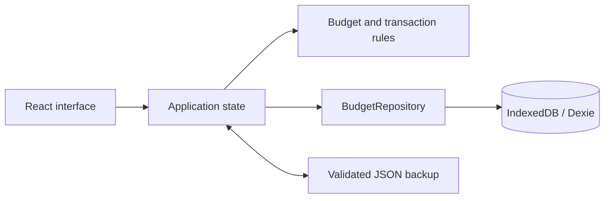

# Mon Budget

A French-language, local-first budget planner built with React, TypeScript and
Vite. The installable PWA works offline and stores data on the current device.

## Features

- Monthly budgets, empty months and carry-forward with independent identifiers.
- Reorderable income, accounts, expense categories and planned expenses.
- Integer-cent calculations, allocation alerts and an accessible Sankey diagram.
- Local IndexedDB persistence and validated, versioned JSON backup and restore.
- Revolut CSV preview, duplicate detection, classification and monthly actuals.
- Persistent system, light and dark themes with a blue-violet glass interface.
- Floating desktop sidebar and mobile dock, iOS safe areas and 44px primary targets.
- Reduced-motion, reduced-transparency and increased-contrast styles.

No server, bank credentials, live banking connection or shared-household service
is implemented. No personal balances, statements or archived screenshots are
included. A fresh installation starts with zero amounts.

## Development

Use a current Node.js release supported by Vite and npm.

```powershell
npm ci
npm run dev
```

Open the local URL printed by Vite.

| Command | Purpose |
| --- | --- |
| `npm run dev` | Development server |
| `npm run build` | TypeScript checks and production PWA build |
| `npm run preview` | Serve the production build locally |
| `npm run lint` | Static analysis |
| `npm test` | Unit and integration tests |
| `npm run test:watch` | Unit tests in watch mode |
| `npm run test:e2e` | Chromium desktop and emulated iPhone browser tests |

Install the browser once before running end-to-end tests:

```powershell
npx playwright install chromium
npm run build
npm run test:e2e
```

The iPhone project emulates a mobile viewport in Chromium; it is not a native
Safari/WebKit test.

## Installation and hosting

Build with `npm run build` and serve `dist` over HTTPS. The current configuration
expects an origin-root deployment, not a repository subpath. Configure the host
to return `index.html` for application routes such as `/operations` and
`/sauvegarde`. Localhost can be used without HTTPS for development.

On iPhone, open the site in Safari and choose **Share > Add to Home Screen**.
On desktop Chromium, use the browser's install action. Open the application online
once so its service worker can cache the application shell before offline use.

## Revolut CSV import

Open **Operations** (`Opérations` in the UI), select a CSV statement, review the
preview and confirm the import. Assign expense categories or correct the
expense, income and transfer classification afterward.

- Required columns: `Description`, `Amount`, `Currency`, `State`, and either
  `Started Date` or `Completed Date`. Common French headings are also supported.
- Comma, semicolon and tab delimiters are accepted; the file limit is 10 MB.
- Only completed transactions are imported. Reimport pending transactions after
  they settle.
- Stable fingerprints prevent duplicates within a file and across overlapping
  statements.
- Non-EUR transactions remain visible but are not converted or counted in EUR totals.
- Imported actuals remain separate from planned expenses. An import can be undone
  immediately, and individual transactions can be deleted.

Files are parsed locally and are not uploaded to a server.

## Data and backups

Budgets, imported transactions and classification are stored in IndexedDB.
Theme preferences are stored separately in local storage. Clearing site data,
changing browser or changing the site's origin does not transfer these records.
Browsers, especially iOS, may evict local data: export JSON backups regularly
using the **Backup** (`Sauvegarde`) page and keep them outside the browser.

Restore validates the document version, identifiers and references before showing
a preview. Existing data is replaced only after confirmation. Version 1 budget
backups are migrated to the current transaction-aware schema.



Domain rules live in `src/domain`, persistence in `src/data`, application state
and themes in `src/app`, screens in `src/features`, and design tokens and
responsive styles in `src/styles`.

## Restoration

The application sources and existing tests were recovered from the successful
edits and file snapshots in the original September 2026 conversation export,
including the completed glass-interface redesign. The missing Lucide dependency
was restored, PNG installation icons were regenerated from the recovered SVG,
and a new npm lockfile was generated. The old lockfile and exact original PNG
binaries were not available. Conversation exports, original financial prototype
values and private screenshots are intentionally excluded.
