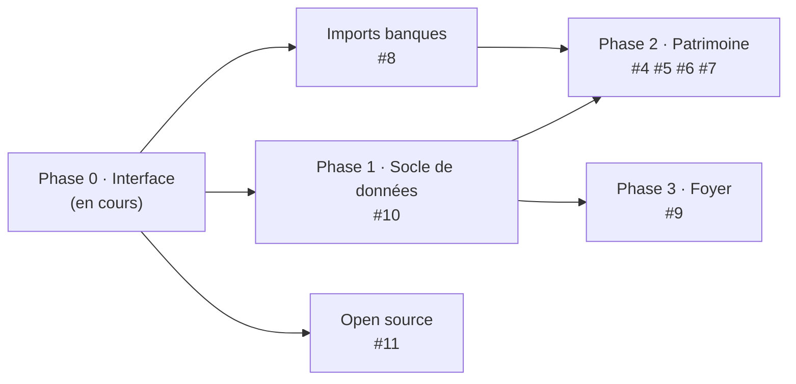

# Roadmap

## Vue d'ensemble

### Objectif

Finance devient un « Finary personnel » open source pour gérer les finances du
foyer : budgets (prévu contre réel), épargne, projets et coût des prêts, et suivi
du patrimoine global. Les connecteurs bancaires de Finary ne fonctionnent pas
pour les banques utilisées ici, donc l'application mise sur la saisie manuelle et
l'import de fichiers (Revolut est déjà fait), avec des graphiques de l'évolution
de l'épargne et des investissements dans le temps.

### Où on en est

- Déjà en place : budget mensuel, planning, import Revolut, synchro Supabase et
  mode hors ligne, un document de données par compte.
- En cours : reconstruction de l'interface (Tailwind, shadcn/ui, calendrier
  annuel), voir [ADR 0001](./adr/0001-ui-stack.md).
- Ensuite : patrimoine et stockage, voir [ADR 0002](./adr/0002-wealth-tracking.md)
  (statut : proposé, rien n'est décidé).

### Les phases

### Ce qu'il faut décider

- Le moteur de synchronisation (PowerSync, Electric, TanStack DB, ou rien), à
  trancher après un test court. Tant que ce n'est pas fait, on peut démarrer le
  patrimoine à petite échelle dans le document actuel, avec un risque de reprise.
- La licence du projet, à choisir avant d'ouvrir le dépôt.

### Compromis

- Passer à des tables par entité demande une migration à tester avec retour
  arrière, mais c'est la condition du partage à deux et d'un historique de
  patrimoine qui grandit.
- Les imports dépendent du format réel des exports de chaque banque, à confirmer
  sur de vrais fichiers (jamais commités).

---

## Technical roadmap (English)

Direction and rationale: [ADR 0001 (UI stack)](./adr/0001-ui-stack.md) and
[ADR 0002 (wealth tracking, Proposed)](./adr/0002-wealth-tracking.md).

| Phase | Item | Issue | Depends on |
| --- | --- | --- | --- |
| 0 | UI rebuild (Tailwind v4, shadcn/ui, TanStack Router, dnd-kit, TanStack Table), yearly month calendar | in progress on the UI branch | none |
| 1 | Normalized data model and sync engine (ADR 0002) | [#10](https://github.com/victorsauter/finance/issues/10) | UI rebuild merged |
| 2 | Net worth: accounts, valuations, evolution chart | [#4](https://github.com/victorsauter/finance/issues/4) | #10 (or a spike inside the current document) |
| 2 | Investments tracking | [#5](https://github.com/victorsauter/finance/issues/5) | #4 |
| 2 | Loans: schedule, remaining capital, total cost | [#6](https://github.com/victorsauter/finance/issues/6) | #4 |
| 2 | Savings goals and projects | [#7](https://github.com/victorsauter/finance/issues/7) | #4, optionally #6 |
| 2 | CSV importers: Crédit Mutuel, Crédit Agricole, Trade Republic | [#8](https://github.com/victorsauter/finance/issues/8) | Existing Revolut importer; #5 for broker contributions |
| 3 | Household sharing | [#9](https://github.com/victorsauter/finance/issues/9) | #10 |
| Any | Open-source readiness: license, README, personal deploy config split | [#11](https://github.com/victorsauter/finance/issues/11) | none |

### Notes

- Phases are an ordering of dependencies, not dates.
- Issue #10 should produce a spike report in ADR 0002 before the status moves
  from Proposed to Accepted.
- No personal data, balances or real bank statements belong in issues, docs or
  test fixtures; importers use synthetic files.
