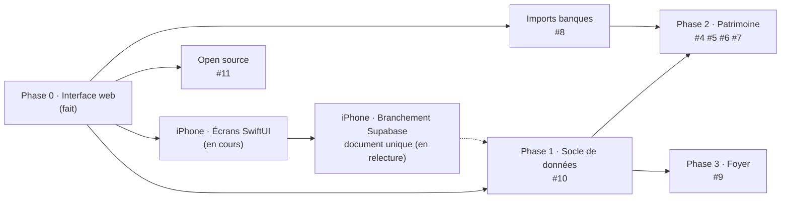

# Roadmap

## Vue d'ensemble

### Objectif

Finance devient un « Finary personnel » open source pour gérer les finances du
foyer : budgets (prévu contre réel), épargne, projets et coût des prêts, et suivi
du patrimoine global. Les connecteurs bancaires de Finary ne fonctionnent pas
pour les banques utilisées ici, donc l'application mise sur la saisie manuelle et
l'import de fichiers (Revolut est déjà fait), avec des graphiques de l'évolution
de l'épargne et des investissements dans le temps.

### Où on en est

- Déjà en place : budget mensuel, planning, import Revolut, synchro Supabase et
  mode hors ligne, un document de données par compte.
- Fait : reconstruction de l'interface web (Tailwind, shadcn/ui, calendrier
  annuel), voir [ADR 0001](./adr/0001-ui-stack.md).
- En cours : application iPhone native en SwiftUI, voir
  [ADR 0003](./adr/0003-native-ios-client.md). Le web reste l'interface pour
  l'ordinateur.
- Étape 4 (en relecture) : l'iPhone se connecte à Supabase exactement comme le
  web, avec le même document unique par compte. Connexion par code reçu par
  e-mail, modifications hors ligne envoyées au retour du réseau, et en cas de
  conflit on garde une copie entière (celle de l'iPhone ou celle du cloud).
  Pas de moteur de synchronisation ni de service hébergé en plus : un seul
  utilisateur, un appareil à la fois. PowerSync a été testé puis écarté car il
  demande un hébergement.
- Ensuite : patrimoine et stockage, voir [ADR 0002](./adr/0002-wealth-tracking.md)
  (statut : proposé, rien n'est décidé).

### Les phases

### Ce qu'il faut décider

- Pour l'iPhone, c'est tranché : pas de moteur de synchronisation, le document
  unique suffit. Les tables par entité restent une étape ultérieure, utile pour
  l'historique du patrimoine et le partage à deux (ADR 0002).
- La licence du projet, à choisir avant d'ouvrir le dépôt.

### Compromis

- Passer à des tables par entité demande une migration à tester avec retour
  arrière, mais c'est la condition du partage à deux et d'un historique de
  patrimoine qui grandit.
- Les imports dépendent du format réel des exports de chaque banque, à confirmer
  sur de vrais fichiers (jamais commités).

---

## Technical roadmap (English)

Direction and rationale: [ADR 0001 (UI stack)](./adr/0001-ui-stack.md),
[ADR 0002 (wealth tracking, Proposed)](./adr/0002-wealth-tracking.md) and
[ADR 0003 (native iPhone client)](./adr/0003-native-ios-client.md).

| Phase | Item | Issue | Depends on |
| --- | --- | --- | --- |
| 0 | UI rebuild (Tailwind v4, shadcn/ui, TanStack Router, dnd-kit, TanStack Table), yearly month calendar | done (#12) | none |
| iOS | Native iPhone app: foundations and v1 screens on local data (ADR 0003) | in progress under `ios/` | none |
| iOS | Stage 4: connect the iPhone app to Supabase on the single JSON document (email code sign-in, offline edits, whole-copy conflict choice); no sync engine | in review (`feat/ios-supabase`) | v1 screens |
| 1 | Normalized data model and sync engine (ADR 0002) | [#10](https://github.com/victorsauter/finance/issues/10) | UI rebuild merged |
| 2 | Net worth: accounts, valuations, evolution chart | [#4](https://github.com/victorsauter/finance/issues/4) | #10 (or a spike inside the current document) |
| 2 | Investments tracking | [#5](https://github.com/victorsauter/finance/issues/5) | #4 |
| 2 | Loans: schedule, remaining capital, total cost | [#6](https://github.com/victorsauter/finance/issues/6) | #4 |
| 2 | Savings goals and projects | [#7](https://github.com/victorsauter/finance/issues/7) | #4, optionally #6 |
| 2 | CSV importers: Crédit Mutuel, Crédit Agricole, Trade Republic | [#8](https://github.com/victorsauter/finance/issues/8) | Existing Revolut importer; #5 for broker contributions |
| 3 | Household sharing | [#9](https://github.com/victorsauter/finance/issues/9) | #10 |
| Any | Open-source readiness: license, README, personal deploy config split | [#11](https://github.com/victorsauter/finance/issues/11) | none |

### Notes

- Phases are an ordering of dependencies, not dates.
- The iPhone no longer waits for #10: it uses the same single document as the
  web. Entity tables remain a later step for wealth history and household
  sharing; the iPhone moves with the web when they land.
- Issue #10 should produce a spike report in ADR 0002 before the status moves
  from Proposed to Accepted.
- No personal data, balances or real bank statements belong in issues, docs or
  test fixtures; importers use synthetic files.
