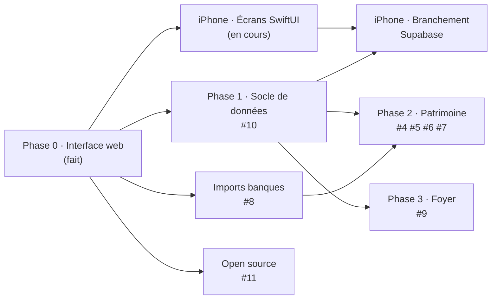

# Roadmap

## Vue d'ensemble

### Objectif

Finance devient un « Finary personnel » open source pour gérer les finances du
foyer : budgets (prévu contre réel), épargne, projets et coût des prêts, et suivi
du patrimoine global. Les connecteurs bancaires de Finary ne fonctionnent pas
pour les banques utilisées ici, donc l'application mise sur la saisie manuelle et
l'import de fichiers (Revolut est déjà fait), avec des graphiques de l'évolution
de l'épargne et des investissements dans le temps.

### Où on en est

- Déjà en place : budget mensuel, planning, import Revolut, synchro Supabase et
  mode hors ligne, un document de données par compte.
- Fait : reconstruction de l'interface web (Tailwind, shadcn/ui, calendrier
  annuel), voir [ADR 0001](./adr/0001-ui-stack.md).
- En cours : application iPhone native en SwiftUI, voir
  [ADR 0003](./adr/0003-native-ios-client.md). Le web reste l'interface pour
  l'ordinateur.
- En cours : socle de données (#10), voir
  [ADR 0002](./adr/0002-wealth-tracking.md). Le moteur de synchronisation est
  choisi : PowerSync. Les tables par entité, la conversion réversible et le test
  sont faits sur un Supabase local ; rien n'est encore migré en production.
- Ensuite : patrimoine, une fois le socle de données en service.

### Les phases

### Ce qu'il faut décider

- Décidé : le moteur de synchronisation est PowerSync (test réussi, voir
  l'ADR 0002).
- L'hébergement de PowerSync : sur ton Kubernetes (recommandé, sans coût en
  plus) ou PowerSync Cloud (gratuit avec mise en pause, sinon 49 $ par mois).
- Le feu vert pour la migration en production, qui ne se fait pas sans ton
  accord explicite.
- La licence du projet, à choisir avant d'ouvrir le dépôt.

### Compromis

- Passer à des tables par entité demande une migration à tester avec retour
  arrière, mais c'est la condition du partage à deux et d'un historique de
  patrimoine qui grandit.
- Les imports dépendent du format réel des exports de chaque banque, à confirmer
  sur de vrais fichiers (jamais commités).

---

## Technical roadmap (English)

Direction and rationale: [ADR 0001 (UI stack)](./adr/0001-ui-stack.md),
[ADR 0002 (wealth tracking and storage, Accepted with PowerSync)](./adr/0002-wealth-tracking.md) and
[ADR 0003 (native iPhone client)](./adr/0003-native-ios-client.md).

| Phase | Item | Issue | Depends on |
| --- | --- | --- | --- |
| 0 | UI rebuild (Tailwind v4, shadcn/ui, TanStack Router, dnd-kit, TanStack Table), yearly month calendar | done (#12) | none |
| iOS | Native iPhone app: foundations and v1 screens on local data (ADR 0003) | in progress under `ios/` | none |
| iOS | Connect the iPhone app to Supabase (sign-in, sync, offline) | not started | #10 |
| 1 | Normalized data model and sync engine (ADR 0002): entity tables, reversible conversion and PowerSync spike | done locally ([#10](https://github.com/victorsauter/finance/issues/10)) | UI rebuild merged |
| 1 | Pre-rollout follow-ups: deterministic ids, atomic import/restore function, compare-before-write, sign-out rule | not started | #10 |
| 1 | PowerSync hosting, production migration and web client switch | not started, needs the owner's go-ahead | hosting decision, follow-ups above |
| 2 | Net worth: accounts, valuations, evolution chart | [#4](https://github.com/victorsauter/finance/issues/4) | #10 (or a spike inside the current document) |
| 2 | Investments tracking | [#5](https://github.com/victorsauter/finance/issues/5) | #4 |
| 2 | Loans: schedule, remaining capital, total cost | [#6](https://github.com/victorsauter/finance/issues/6) | #4 |
| 2 | Savings goals and projects | [#7](https://github.com/victorsauter/finance/issues/7) | #4, optionally #6 |
| 2 | CSV importers: Crédit Mutuel, Crédit Agricole, Trade Republic | [#8](https://github.com/victorsauter/finance/issues/8) | Existing Revolut importer; #5 for broker contributions |
| 3 | Household sharing | [#9](https://github.com/victorsauter/finance/issues/9) | #10 |
| Any | Open-source readiness: license, README, personal deploy config split | [#11](https://github.com/victorsauter/finance/issues/11) | none |

### Notes

- Phases are an ordering of dependencies, not dates.
- The spike report and the decision (PowerSync) are in ADR 0002. Hosting is
  still open, and the rollout and rollback steps are listed there and in the
  pull request for #10.
- No personal data, balances or real bank statements belong in issues, docs or
  test fixtures; importers use synthetic files.
