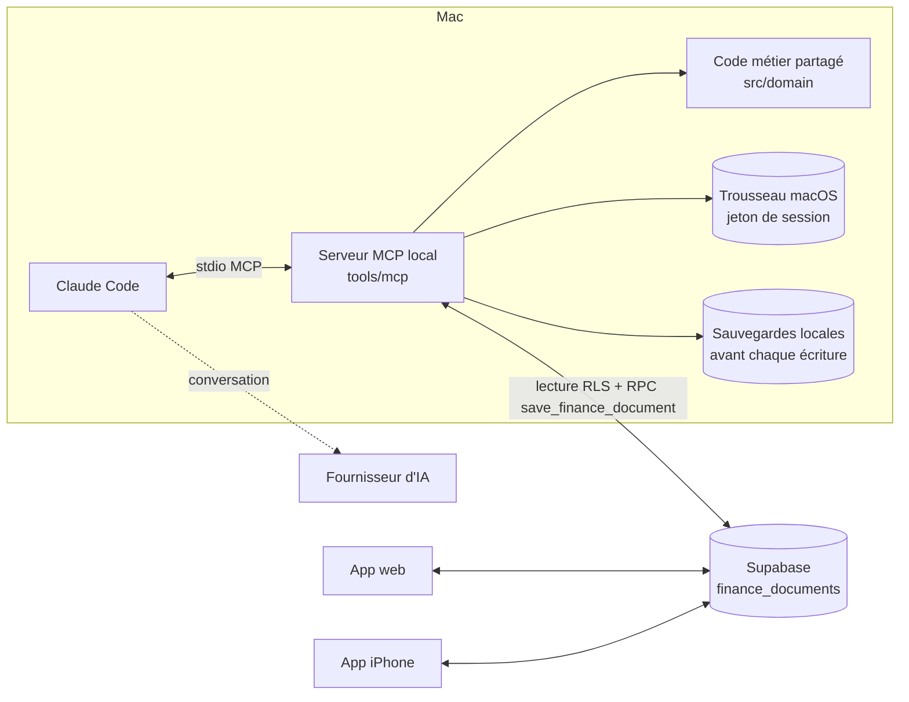

# ADR 0004: Local MCP server for Claude Code

- Status: Accepted
- Date: 2026-11-18
- Deciders: project owner

## Vue d'ensemble (pour le propriétaire)

**Objectif.** Pouvoir demander à Claude Code d'analyser le budget et les
transactions (« combien ai-je dépensé en courses depuis janvier ? ») et de faire
le travail répétitif de classement (« range toutes les transactions Lidl dans
Courses », « marque les virements vers mes poches comme transferts »), sans
ouvrir l'application.

**Proposition retenue.** Un petit serveur MCP qui tourne **sur le Mac**, lancé
par Claude Code (`tools/mcp/`). Il se connecte à Supabase **avec mon propre
compte** (code reçu par email, jeton gardé dans le Trousseau macOS), lit le
même document que l'app web et l'app iPhone, et l'écrit par la même fonction
`save_finance_document` qu'elles. Il réutilise le code métier de l'app web
(validation, totaux), donc les chiffres sont les mêmes partout.

**Ce qui change.** Un dossier `tools/mcp/`, un fichier `.mcp.json`, quatre
commandes npm (`mcp:login`, `mcp:logout`, `mcp:status`, `mcp:start`).
**Ce qui ne change pas.** L'app web, l'app iPhone, la base Supabase et ses
règles d'accès : rien de nouveau côté serveur, aucune clé d'administration.

**Garde-fous.**
- Toute modification est d'abord un **essai à blanc** (`dry_run`, par défaut) :
  Claude montre l'avant/après, je valide, puis il applique.
- Avant chaque écriture réelle, une **sauvegarde locale** du document est
  faite (30 gardées) ; `restore_backup` permet de revenir en arrière.
- Si l'app a modifié les données entre-temps, l'écriture est **refusée**
  (conflit de révision) au lieu d'écraser.
- Au plus 200 changements par appel ; tout identifiant inconnu ou catégorie
  introuvable annule tout l'appel.
- `FINANCE_MCP_READ_ONLY=1` : mode lecture seule, les outils d'écriture
  n'existent plus.

**Compromis à accepter.** Ce que le serveur lit (montants, commerçants,
catégories) est envoyé au fournisseur d'IA dans la conversation, comme tout ce
que je tape. Rien n'est hébergé ailleurs. Le jeton est celui de mon compte :
le serveur peut faire tout ce que je peux faire dans l'app, mais pas plus.

## Context

All of a user's data is one JSON document (`AppData` schema v2) in
`public.finance_documents`, readable by its owner under row-level security and
written only through `save_finance_document(document, expected_revision,
mutation_id)`, a compare-and-swap on an integer revision that is idempotent on
the mutation id (ADR 0003, "Sync"). Classifying hundreds of imported bank
transactions one by one in the UI is the most tedious task in the app, and
analysis questions need ad-hoc aggregation the UI does not offer. Claude Code
supports MCP servers declared per project in `.mcp.json`.

## Decision

Add a local stdio MCP server in `tools/mcp/`, written in TypeScript with the
official `@modelcontextprotocol/sdk` and run by Node's built-in type stripping
(no build step; a small resolve hook handles the web code's extensionless
imports).

| Concern | Choice |
| --- | --- |
| Transport | stdio, started by Claude Code from `.mcp.json` (`npm run --silent mcp:start`) |
| Identity | Owner's own account: email OTP (`shouldCreateUser: false`), publishable key only |
| Secret storage | Refresh token + user id in the macOS Keychain via `/usr/bin/security`, written on stdin; rotated tokens written back on every refresh |
| Data access | `SupabaseTransport` from the web app (RLS read, `save_finance_document` write) |
| Domain logic | Reused from `src/domain` and `src/features/transactions/month-summary.ts` |
| Writes | Targeted operations on a clone, `parseAppData`, then one RPC call with the read revision and a fresh UUID mutation id |
| Safety | `dry_run` default true; pre-write local backup (0600, newest 30); no retry on conflict; 200 changes per call; all-or-nothing validation |
| Read-only mode | `FINANCE_MCP_READ_ONLY=1` does not register write tools |
| Web bundle | `tools/` is outside the app's TypeScript project and Vite graph; `tsc -b` checks it via `tools/mcp/tsconfig.json` |

Tool list, spending definition and transfer handling are documented in
[`tools/mcp/README.md`](../../tools/mcp/README.md).

Transaction classification is the primary use case: `merchant_summary`,
`list_uncategorized`, `categorize_by_description` and `set_kind_by_description`
work per merchant, and categories are resolved by name inside each
transaction's own month because category ids are per month.

## Alternatives considered

- **Hosted or remote MCP server** (for example an Edge Function speaking
  streamable HTTP). Rejected: a new public endpoint and an OAuth flow to secure
  for a single user, and no need to use it from anywhere but this Mac.
- **Service-role key.** Rejected: it bypasses row-level security and would sit
  on disk as an all-powerful secret. The owner's session can do exactly what
  the apps can do.
- **Direct SQL / Postgres connection** (or a generic Supabase MCP server).
  Rejected: it needs database credentials, skips the compare-and-swap RPC and
  the `parseAppData` validation, and invites whole-document rewrites.
- **Whole-document read/replace tools.** Rejected: an assistant mistake would
  replace everything. Only targeted operations are exposed; `restore_backup`
  is the single, explicit whole-document write.
- **Retry on conflict.** Rejected: the other device's edit could invalidate the
  change; the assistant must re-read and redo it.
- **Native Keychain module (keytar and similar).** Rejected: a native
  dependency for three commands that `security` already provides.

## Consequences

Positive:

- Bulk classification and analysis from a conversation, with the same totals
  and validation as the apps.
- No new server-side surface: same table, same RPC, same RLS.

Negative and risks:

- Tool results are sent to the AI provider as part of the conversation.
  Mitigation: read-only switch, documented in the README.
- The server can do what the owner can do. Mitigations: dry run by default,
  pre-write backups, the change cap, conflict detection. A backup taken before
  a write that then conflicts stays on disk; it is a copy of what was read.
- The refresh token rotates; if the process dies between a refresh and the
  Keychain write, the next start asks to log in again (`npm run mcp:login`).
- The shared code must stay runnable by Node: type-only imports and erasable
  syntax only (already enforced by `erasableSyntaxOnly`).

Privacy: nothing is hosted; backups stay in
`~/Library/Application Support/Finance/mcp-backups/`; no secret is in the
repository (the publishable key is public browser configuration).

Recovery: `restore_backup` (or the web app's Backup page with the backup's
`data`) undoes a bad write. Removing `tools/mcp/`, `.mcp.json` and the four npm
scripts, then `npm run mcp:logout`, removes the feature entirely.
